# Meridian: documentação da versão inicial

Sistema web de controle de frota para pequenas empresas de logística e transporte.
Trabalho de Curso, Bacharelado em Sistemas de Informação, IESGO, 2026.


## Sumário

1. [Introdução](#1-introdução)
2. [Requisitos](#2-requisitos)
3. [Tecnologias](#3-tecnologias)
4. [Arquitetura](#4-arquitetura)
5. [Modelo de dados](#5-modelo-de-dados)
6. [Regras de negócio](#6-regras-de-negócio)
7. [Contrato da API](#7-contrato-da-api)
8. [Interface do sistema](#8-interface-do-sistema)
9. [Testes e qualidade](#9-testes-e-qualidade)
10. [Como executar](#10-como-executar)
11. [Limitações e próximas etapas](#11-limitações-e-próximas-etapas)
12. [Referências](#referências)

---

## 1. Introdução

### 1.1 Contexto e problema

Pequenas empresas de logística e transporte costumam controlar a frota com planilhas, cadernos e lembretes informais. Com esse controle disperso, fica difícil saber a quilometragem atual de cada veículo e quanto foi gasto em manutenção. Fica mais difícil ainda saber quando vence a próxima manutenção preventiva. Uma revisão esquecida aumenta o risco de quebra na estrada, o custo com manutenção corretiva e o tempo em que o veículo fica parado.

O **Meridian** centraliza essas informações em um único sistema web, acessível pelo computador ou pelo celular. Ele avisa o gestor antes que uma manutenção vença, seja pela data, seja pela quilometragem.

### 1.2 Objetivos

**Objetivo geral:** desenvolver um sistema web de controle de frota que centralize o cadastro de veículos e motoristas, registre as manutenções e alerte sobre as manutenções preventivas próximas do vencimento, por quilometragem ou por data.

**Objetivos específicos:**

- implementar a autenticação de usuários com dois perfis de acesso (Administrador e Gestor de frota);
- permitir cadastrar, consultar, editar e inativar veículos e motoristas, validando os documentos brasileiros (placa, chassi, RENAVAM, CPF e CNH);
- apresentar um painel com indicadores de quilometragem, custos e manutenções;
- gerar alertas de manutenção preventiva por quilometragem ou por data, programando automaticamente as manutenções recorrentes;
- disponibilizar uma versão de demonstração que funcione sem servidor.

### 1.3 Escopo da versão inicial

Esta versão traz o **front-end completo**, funcionando com uma **API simulada no próprio navegador**. A prioridade foi validar a interface e as regras de negócio antes de investir no servidor.

O simulador atende as mesmas rotas REST que a API real terá. As validações, as mensagens de erro e os códigos HTTP também são os mesmos, e todo esse comportamento é coberto por testes automatizados. Por isso, ele funciona como uma **especificação executável do back-end**: o contrato das rotas ([seção 7](#7-contrato-da-api)), o modelo de dados ([seção 5](#5-modelo-de-dados)) e as regras de negócio ([seção 6](#6-regras-de-negócio)) já estão definidos e verificados.

Para trocar o simulador por uma API real, basta configurar a variável `VITE_API_URL`. As telas não mudam.

**Fora desta versão:** o servidor e o banco de dados reais, a implantação em produção e o módulo de viagens. O escopo do módulo de viagens ainda será definido com o orientador.

## 2. Requisitos

### 2.1 Requisitos atendidos

| Código | Requisito | Como foi atendido |
| --- | --- | --- |
| RNF01 | Autenticação de usuários | Login com e-mail e senha; todas as telas protegidas; perfis Administrador e Gestor; gestão de usuários; troca de senha; sessão de 8 horas |
| RF01 | Cadastro, consulta, edição e exclusão de veículos e motoristas | Listagens com busca e filtros; validação de placa, chassi, RENAVAM, CPF e CNH; bloqueio de cadastros duplicados; vínculo entre motorista e veículo; exclusão lógica com reativação |
| RF02 | Dashboard com indicadores de quilometragem, custos e manutenções | Indicadores da frota; custo mensal dos últimos 12 meses; custos de preventiva × corretiva; custo e quilometragem por veículo |
| RF03 | Alertas de manutenção preventiva por km ou por data | Situação calculada (em dia, próxima do limite, vencida); antecedência configurável; próxima preventiva programada automaticamente ao concluir; alertas de CNH vencida ou vencendo |

### 2.2 Outras características de qualidade

- **Responsividade:** o sistema funciona no computador e no celular. No celular, o menu vira uma gaveta e as listagens viram cartões.
- **Padrões brasileiros:** datas, moeda, placas no padrão antigo e no Mercosul. A data de referência é calculada no fuso de Brasília.
- **Erros por campo:** as mensagens de erro apontam exatamente qual campo do formulário corrigir.
- **Integridade:** cada alteração é aplicada por inteiro ou não é aplicada, como uma transação de banco de dados.

### 2.3 Perfis de acesso

| Funcionalidade | Administrador | Gestor de frota |
| --- | :---: | :---: |
| Dashboard e alertas | ✔ | ✔ |
| Veículos, motoristas e manutenções | ✔ | ✔ |
| Trocar a própria senha | ✔ | ✔ |
| Gerenciar usuários | ✔ | — |
| Alterar a antecedência dos alertas | ✔ | — |
| Restaurar os dados de demonstração | ✔ | — |

## 3. Tecnologias

| Tecnologia | Versão | Uso no projeto |
| --- | --- | --- |
| React | 19.3 | Construção da interface em componentes |
| TypeScript | 6.0 | Tipagem estática de todo o código |
| Vite | 8.3 | Servidor de desenvolvimento e geração da versão de produção |
| React Router | 8.4 | Navegação entre telas e rotas protegidas |
| Tailwind CSS | 4.3 | Estilização e identidade visual (paleta azul) |
| Zod | 4.6 | Validação dos dados recebidos pela API |
| lucide-react | 1.50 | Ícones |
| Vitest | 5.0 | Testes automatizados |
| oxlint | 1.86 | Análise estática do código |
| Node.js | 24 | Ambiente de desenvolvimento (mínimo 22.12) |

## 4. Arquitetura

### 4.1 Visão geral

O sistema é uma aplicação de página única (SPA) organizada em camadas. As telas não sabem de onde vêm os dados: elas pedem as informações ao cliente da API. É o cliente que decide para onde vai a requisição: para a API simulada (versão atual) ou para uma API real em servidor (próxima etapa).

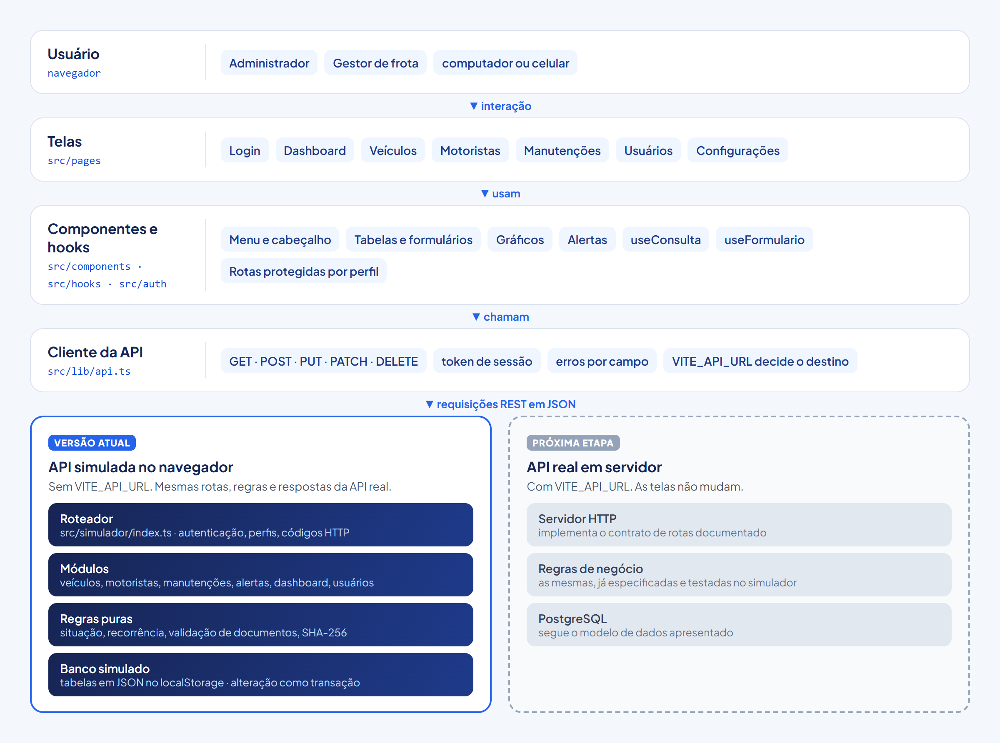

### 4.2 Organização do código

| Pasta | Responsabilidade |
| --- | --- |
| `src/pages` | Telas do sistema, uma pasta por funcionalidade |
| `src/components` | Componentes reutilizáveis: genéricos (botões, campos, janelas, tabelas) e específicos do sistema (placa, gráficos, menu) |
| `src/auth` | Login, sessão e proteção das rotas por perfil |
| `src/hooks` | Lógica de tela reaproveitável: consultas à API e controle dos formulários |
| `src/lib` | Cliente da API, tipos dos dados, formatação e máscaras dos campos |
| `src/simulador` | API simulada: roteador, módulos de negócio, regras e banco no `localStorage` |

### 4.3 Fluxo de uma requisição

Exemplo: o usuário conclui uma manutenção.

1. O usuário clica em **Concluir** e informa a data, a quilometragem e o custo do serviço.
2. A tela envia `POST /manutencoes/:id/concluir` pelo cliente da API, junto com o token da sessão.
3. O roteador confere a sessão e o perfil do usuário e chama o módulo de manutenções.
4. O módulo valida os dados, marca a manutenção como realizada e atualiza o hodômetro do veículo.
5. Se a manutenção for recorrente, a próxima é programada a partir da data e da quilometragem do serviço.
6. A alteração só é gravada se todas as etapas derem certo. A tela recebe a resposta e atualiza a lista e os alertas.

### 4.4 API simulada

A cada requisição, o simulador:

1. localiza a rota correspondente;
2. verifica o login e o perfil do usuário;
3. executa o módulo de negócio daquela rota.

Quando a requisição altera dados, o trabalho é feito sobre uma cópia do banco. Essa cópia só substitui os dados anteriores se tudo der certo, como numa transação de banco de dados. As respostas são convertidas em JSON, então a tela recebe exatamente o que receberia de uma API HTTP.

Os dados ficam no `localStorage` do navegador. Na primeira execução, o sistema cria uma frota de demonstração com 6 veículos, 5 motoristas e 24 manutenções. As datas são calculadas a partir do dia atual, para que sempre existam situações de alerta para mostrar.

## 5. Modelo de dados

O modelo lógico relacional abaixo mostra as tabelas, as colunas, as chaves e os relacionamentos, na notação pé de galinha. As tabelas são exatamente as que a API simulada usa. Os tipos das colunas seguem o padrão do PostgreSQL, que é a proposta para o banco de dados real.

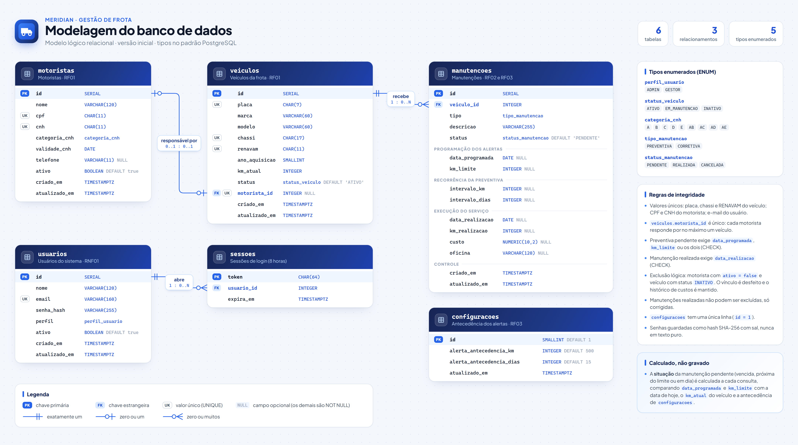

### 5.1 Tabelas

| Tabela | Finalidade | Principais campos |
| --- | --- | --- |
| `usuarios` | Pessoas com acesso ao sistema | nome, e-mail (único), hash da senha, perfil, ativo |
| `sessoes` | Sessões de login abertas | token, usuário, data de expiração |
| `motoristas` | Motoristas da frota | nome, CPF e CNH (únicos), categoria e validade da CNH, telefone, ativo |
| `veiculos` | Veículos da frota | placa, chassi e RENAVAM (únicos), marca, modelo, ano, km atual, status, motorista responsável |
| `manutencoes` | Manutenções programadas e realizadas | veículo, tipo, status, data programada, km limite, intervalos de recorrência; data, km e custo do serviço realizado |
| `configuracoes` | Antecedência dos alertas (tabela de linha única) | antecedência em km (padrão 500) e em dias (padrão 15) |

### 5.2 Relacionamentos

- **motoristas — veiculos (0..1 : 0..1):** cada veículo tem no máximo um motorista responsável, e cada motorista responde por no máximo um veículo.
- **veiculos — manutencoes (1 : 0..N):** cada manutenção pertence a um único veículo, e cada veículo pode ter várias manutenções.
- **usuarios — sessoes (1 : 0..N):** cada usuário pode ter várias sessões abertas.

A **situação** de uma manutenção (vencida, próxima do limite ou em dia) não é gravada no banco. Ela muda sozinha com o passar dos dias e com a quilometragem, então é calculada a cada consulta.

## 6. Regras de negócio

| Código | Regra |
| --- | --- |
| RN01 | Uma manutenção pendente está **vencida** quando passou da data programada ou quando o veículo atingiu o km limite. Está **próxima do limite** quando faltam até N dias ou N km. Se tiver data e km, vale o que vencer primeiro. |
| RN02 | A antecedência dos alertas é configurável (padrão de 15 dias e 500 km). Só o Administrador pode alterá-la. |
| RN03 | Ao concluir uma preventiva com intervalo (ex.: a cada 10.000 km ou 180 dias), a próxima é programada a partir da data e do km em que o serviço foi feito. |
| RN04 | Uma preventiva pendente precisa de data programada, de km limite ou dos dois. Uma manutenção realizada precisa da data de realização, que não pode estar no futuro. |
| RN05 | O hodômetro só avança: a quilometragem informada não pode ser menor que a atual. |
| RN06 | Veículos e motoristas não são apagados, são inativados (exclusão lógica). Ao inativar, o vínculo entre motorista e veículo é desfeito, mas o histórico de custos é mantido. Os dois podem ser reativados depois. |
| RN07 | Manutenções realizadas não podem ser excluídas, só corrigidas. Manutenções canceladas não podem ser editadas. |
| RN08 | Placa, chassi, RENAVAM, CPF, CNH e e-mail não podem se repetir. O CPF tem os dígitos verificadores conferidos. A placa aceita o padrão antigo e o Mercosul. O chassi tem 17 caracteres e não pode ter as letras I, O e Q. |
| RN09 | A CNH é classificada como vencida, vencendo (dentro da antecedência em dias) ou válida. |
| RN10 | Um usuário inativado perde o acesso imediatamente, mesmo que esteja com a sessão aberta. As senhas são guardadas com sal e hash SHA-256. |
| RN11 | A data de referência ("hoje") é calculada no fuso de Brasília, seja qual for o fuso do computador. |

## 7. Contrato da API

- **Formato:** todas as requisições e respostas usam JSON.
- **Autenticação:** todas as rotas exigem o cabeçalho `Authorization: Bearer <token>`, exceto `GET /health` e `POST /auth/login`.
- **Erros:** seguem o formato abaixo. O campo `detalhes` diz qual campo do formulário destacar.

  ```json
  { "mensagem": "Já existe um cadastro com esta placa.", "detalhes": { "placa": ["Já existe um cadastro com esta placa."] } }
  ```

| Código HTTP | Significado |
| --- | --- |
| 200 | Sucesso |
| 201 | Registro criado |
| 204 | Sucesso, sem conteúdo na resposta |
| 400 | Dados inválidos |
| 401 | Usuário não autenticado |
| 403 | Usuário sem permissão |
| 404 | Não encontrado |
| 409 | Registro duplicado |

| Método | Rota | Descrição | Acesso |
| --- | --- | --- | --- |
| GET | `/health` | Situação da API | Público |
| POST | `/auth/login` | Recebe `{ email, senha }` e devolve `{ token, usuario }` | Público |
| POST | `/auth/logout` | Sair | Logado |
| GET | `/auth/me` | Dados do usuário logado | Logado |
| PUT | `/auth/senha` | Trocar a própria senha | Logado |
| GET · POST | `/usuarios` | Listar e cadastrar usuários | Administrador |
| PUT | `/usuarios/:id` | Editar ou desativar usuário | Administrador |
| GET · POST | `/veiculos` | Listar (com filtros `busca`, `status`) e cadastrar | Logado |
| GET · PUT · DELETE | `/veiculos/:id` | Consultar, editar e inativar | Logado |
| PATCH | `/veiculos/:id/km` | Atualizar o hodômetro | Logado |
| POST | `/veiculos/:id/reativar` | Reativar | Logado |
| GET · POST | `/motoristas` | Listar e cadastrar | Logado |
| GET · PUT · DELETE | `/motoristas/:id` | Consultar, editar e inativar | Logado |
| POST | `/motoristas/:id/reativar` | Reativar | Logado |
| GET · POST | `/manutencoes` | Listar (filtros `veiculoId`, `status`, `tipo`, `situacao`, `busca`) e cadastrar | Logado |
| GET · PUT · DELETE | `/manutencoes/:id` | Consultar, editar e excluir manutenção pendente | Logado |
| POST | `/manutencoes/:id/concluir` | Concluir e programar a próxima preventiva | Logado |
| POST | `/manutencoes/:id/cancelar` | Cancelar | Logado |
| GET | `/alertas` | Alertas de manutenção e de CNH (RF03) | Logado |
| GET | `/dashboard` | Indicadores (RF02) | Logado |
| GET · PUT | `/configuracoes` | Consultar e alterar a antecedência dos alertas | Logado (só o Administrador altera) |

O comportamento de cada rota está implementado em `src/simulador/modulos/` e os testes ficam em `src/simulador/simulador.test.ts`.

## 8. Interface do sistema

A cor da marca é o azul. Verde, amarelo e vermelho ficam reservados para status (em dia, atenção e vencido) e sempre vêm acompanhados de texto, para que a informação não dependa só da cor. A fonte Plus Jakarta Sans vem junto com o projeto, então funciona sem internet.

### Login
O usuário entra com e-mail e senha. Na demonstração, a tela mostra atalhos para os acessos de teste.

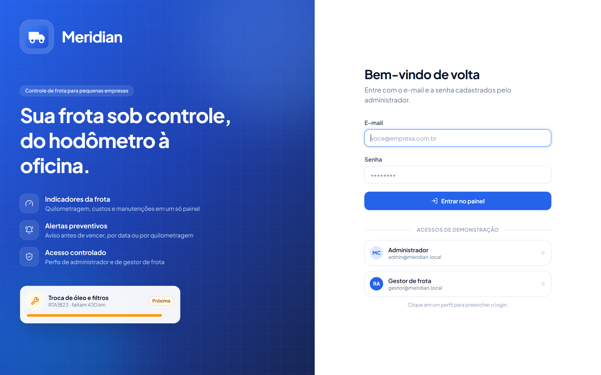

### Dashboard (RF02)
Começa com uma saudação e os alertas do dia. Depois vêm os indicadores (veículos, quilometragem média, custo do mês e manutenções pendentes), a lista de alertas e a validade das CNHs.

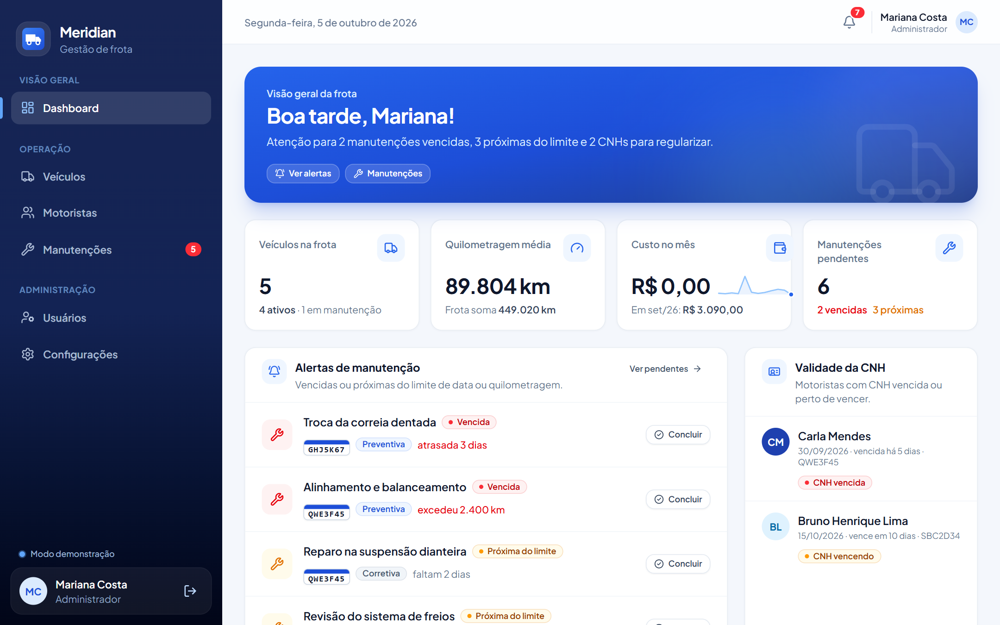

### Veículos (RF01)
Lista os veículos com busca e filtro por status. Os cartões de resumo no topo também funcionam como filtros.

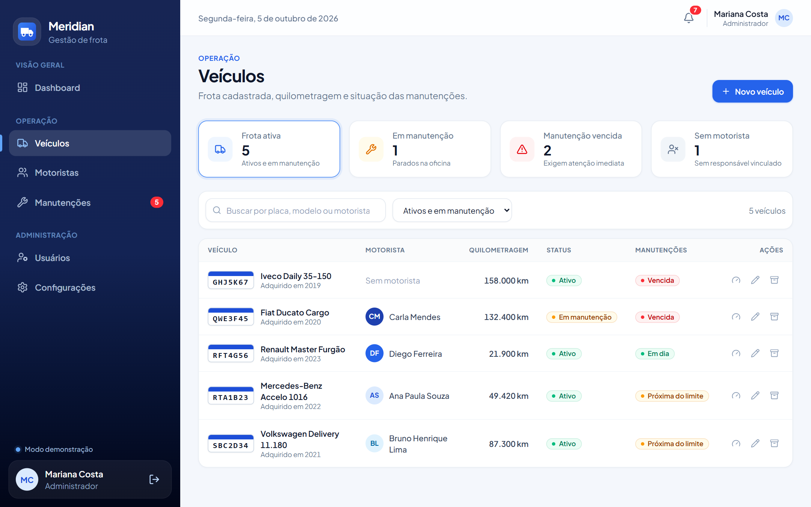

### Detalhe do veículo
Mostra os dados do veículo, o motorista responsável, os custos e o histórico de manutenções. Daqui é possível atualizar o km, editar e inativar o veículo.

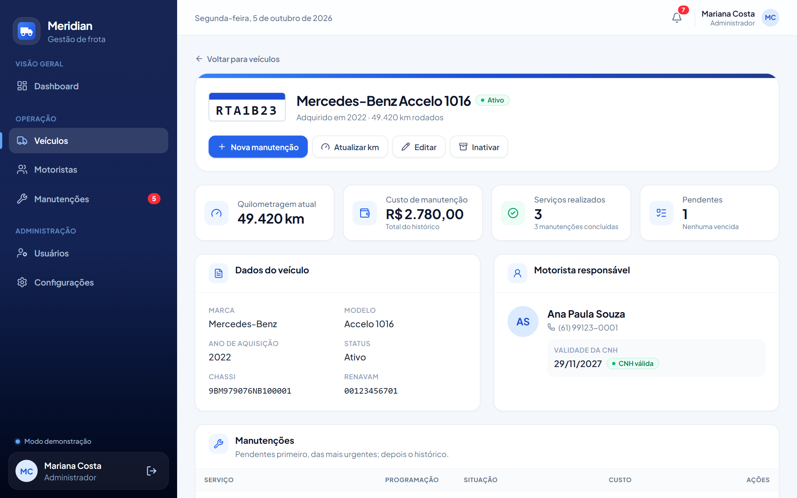

### Motoristas (RF01)
Lista os motoristas com a situação da CNH e o veículo de cada um.

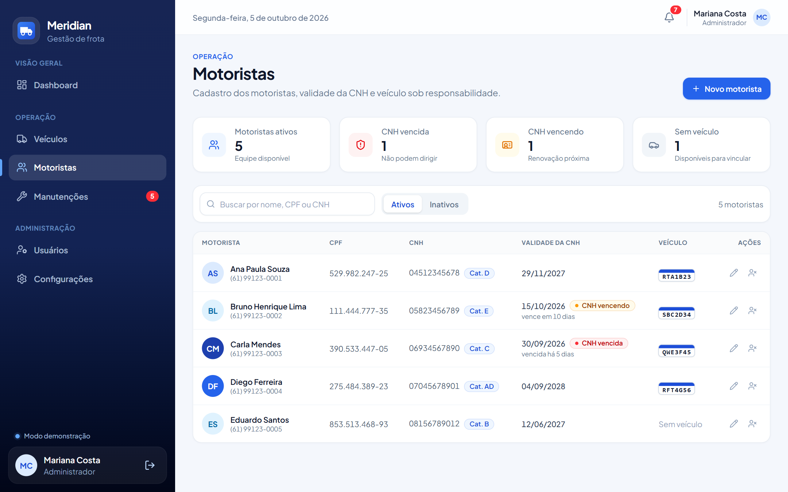

### Manutenções (RF03)
Mostra a situação calculada de cada manutenção. Os cartões do topo filtram as vencidas, as próximas do limite e as pendentes.

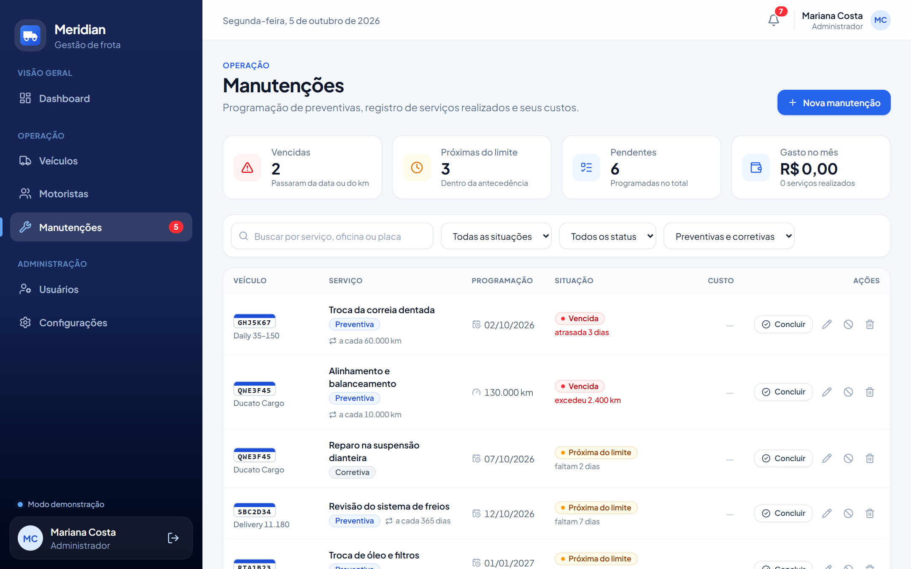

### Cadastro de manutenção
Permite programar uma manutenção por data, por km ou pelos dois, definir de quanto em quanto tempo ela se repete, ou registrar um serviço que já foi feito.

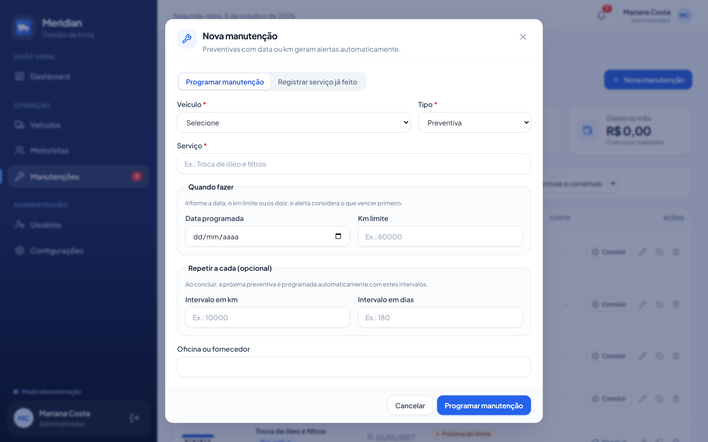

### Usuários (somente o Administrador)

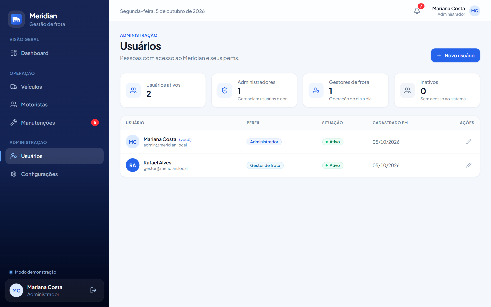

### Configurações
Antecedência dos alertas, troca de senha e restauração dos dados de demonstração.

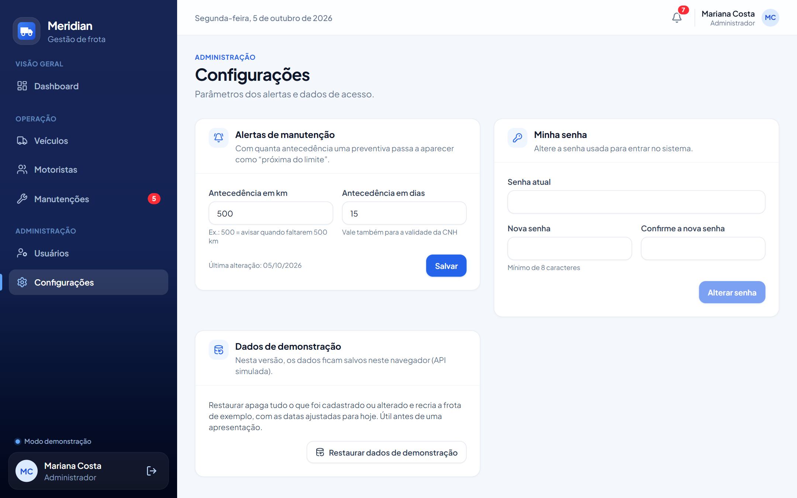

### Celular

<p>
  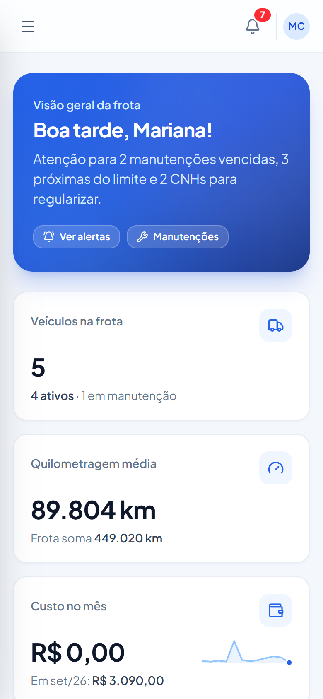
  &nbsp;&nbsp;
  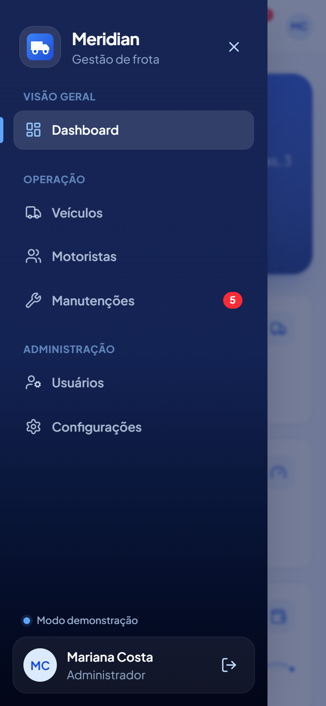
</p>

## 9. Testes e qualidade

O projeto tem **47 testes automatizados**, que rodam com `npm test`.

| Grupo | O que verifica | Testes |
| --- | --- | :---: |
| Autenticação (RNF01) | Login, senha errada, rotas protegidas, logout, acesso restrito ao Administrador, usuário inativado | 6 |
| Veículos (RF01) | Padronização dos documentos, cadastros duplicados, motorista em dois veículos, transação, hodômetro, inativação | 6 |
| Motoristas (RF01) | Validação e duplicidade de CPF, desvínculo do veículo ao inativar | 2 |
| Manutenções e alertas (RF03) | Geração dos alertas, data ou km obrigatório, recorrência, histórico, antecedência | 5 |
| Dashboard e demonstração | Resumo da frota e restauração dos dados | 2 |
| Situação e recorrência | Em dia, próxima, vencida por data e por km, critério que vence primeiro, próxima programação, CNH | 11 |
| Validações | Fuso de Brasília, CPF, placa, chassi, RENAVAM, CNH, telefone, valores, datas, busca, SHA-256 (vetores oficiais do NIST) | 15 |
| **Total** | | **47** |

Além dos testes automatizados:

- **Tipagem:** o comando `npm run typecheck` verifica os tipos de todo o código.
- **Análise estática:** o comando `npm run lint` roda o oxlint.
- **Testes manuais no navegador:**
  - login;
  - cadastros;
  - conclusão de manutenção com recorrência;
  - dados mantidos depois de recarregar a página;
  - acesso com o perfil Gestor;
  - uso em tela de celular.

## 10. Como executar

É preciso ter o Node.js 22.12 ou superior instalado.

```bash
npm install
npm run dev
```

Depois, abra <http://localhost:5173> no navegador.

| Perfil | E-mail | Senha |
| --- | --- | --- |
| Administrador | `admin@meridian.local` | `Frota@2026` |
| Gestor de frota | `gestor@meridian.local` | `Gestor@2026` |

Os usuários de demonstração são pessoas fictícias. Para voltar aos dados originais, entre como Administrador e use **Configurações → Restaurar dados de demonstração**.

## 11. Limitações e próximas etapas

**Limitações da versão inicial**

- Os dados ficam no navegador. Cada navegador tem a sua própria cópia, e os usuários não compartilham dados entre si.
- O login protege a interface, mas não os dados em si. Para proteger os dados de verdade, é preciso um servidor.
- Não há cópia de segurança dos dados nem envio de notificações por e-mail.

**Próximas etapas, até a versão final (10/11/2026)**

- Se fizer parte do escopo final, implementar a API real em **Node.js com TypeScript e Express**, seguindo o [contrato da seção 7](#7-contrato-da-api), e o banco **PostgreSQL**, seguindo o [modelo da seção 5](#5-modelo-de-dados). As validações e as regras de negócio do simulador serão reaproveitadas no servidor.
- Publicar o sistema em um serviço de hospedagem.
- Definir com o orientador o escopo do módulo de viagens.

## Referências

- NATIONAL INSTITUTE OF STANDARDS AND TECHNOLOGY. **FIPS PUB 180-4**: Secure Hash Standard (SHS). Gaithersburg: NIST, 2015. Disponível em: https://doi.org/10.6028/NIST.FIPS.180-4.
- POSTGRESQL GLOBAL DEVELOPMENT GROUP. **PostgreSQL Documentation**. Disponível em: https://www.postgresql.org/docs/.
- REACT. **React Documentation**. Disponível em: https://react.dev.
- REACT ROUTER. **React Router Documentation**. Disponível em: https://reactrouter.com.
- TAILWIND LABS. **Tailwind CSS Documentation**. Disponível em: https://tailwindcss.com/docs.
- TYPESCRIPT. **TypeScript Documentation**. Disponível em: https://www.typescriptlang.org/docs/.
- VITE. **Vite Documentation**. Disponível em: https://vite.dev.
- VITEST. **Vitest Documentation**. Disponível em: https://vitest.dev.
- ZOD. **Zod Documentation**. Disponível em: https://zod.dev.
